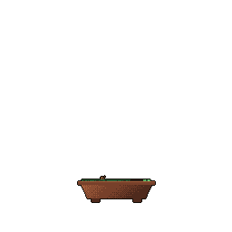

# Hi there!  I am Manjeet Chugh  

  
  

 
Meet <strong>Typo</strong> my pixelated mischief-maker, prowling through my README and leaving a little chaos in his wake.
<picture>
  <source
    media="(prefers-color-scheme: dark)"
    srcset="https://raw.githubusercontent.com/manjeetchugh/manjeetchugh/master/dist/pet.svg"
  >
  <source
    media="(prefers-color-scheme: light)"
    srcset="https://raw.githubusercontent.com/manjeetchugh/manjeetchugh/master/dist/pet-light.svg"
  >
  
</picture>
 

###  About Me
- 🎓 B.Tech student in **Electronics and Communication** Engineering (AI & IoT)  
- 🤖 Exploring **AI**, embedded systems, and open source  
- 🌱 Learning **C** and **Python** by building projects 
---

### 🛠️ Languages & Tools

  

---

###  My GitHub Stats

<table cellspacing="0" cellpadding="0">
  <tr>
    <td align="center" valign="top" width="50%">
      
    </td>
    <td align="center" valign="top" width="50%">
      
    </td>
  </tr>
</table>

 

<table cellspacing="0" cellpadding="0">
  <tr>
    <td align="center" valign="middle" width="320">
      
       
      
    </td>
    <td align="left" valign="middle">
      
     
### 🌳 My One-of-a-Kind Github Bonsai

My bonsai is a little windswept tree with a crooked trunk and a tiny shoot at the top. It’s still growing, and honestly, that’s what I like about it.

It reminds me of how I code. I jump between C, Python, JavaScript, and TypeScript, mess around with new ideas, and keep exploring things like AI and embedded systems. Not everything follows a straight path, and neither does this tree.

It may not have a huge canopy yet, but there’s plenty of room for it to grow. Just like my projects, it’ll take shape over time.

**Still learning. Still experimenting. Still growing.** 🌱

  
      

   </td>
  </tr>
</table>
 
### ⏳ Year Progress

**{ ████████████████████████▁▁▁▁▁▁ } 81.40%**

As of ⏰ 25-Oct-2026

 

###  My Contribution Graph

<picture>
  <source
    media="(prefers-color-scheme: dark)"
    srcset="https://raw.githubusercontent.com/manjeetchugh/manjeetchugh/master/dist/graph.svg"
  >
  <source
    media="(prefers-color-scheme: light)"
    srcset="https://raw.githubusercontent.com/manjeetchugh/manjeetchugh/master/dist/graph-light.svg"
  >
  
</picture>
 

---

###  A Quote to Think About

<a href="https://github.com/marketplace/actions/quote-readme">
<!--STARTS_HERE_QUOTE_README-->
<i>❝The important thing is to never stop questioning.❞</i>
<!--ENDS_HERE_QUOTE_README-->
</a>

---

### 🎮 Outside of Coding

I enjoy playing table tennis, chess, and 8-ball pool. Feel free to connect for a game of chess!  

---

  <b>Thanks for stopping by! ✨</b>

  

